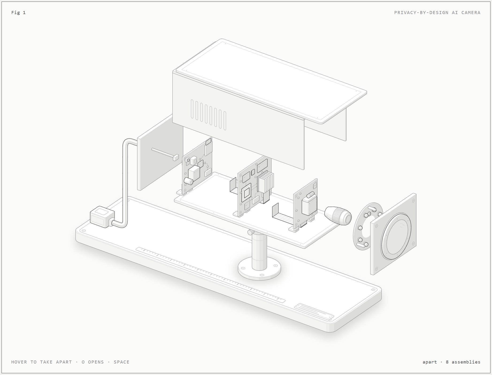
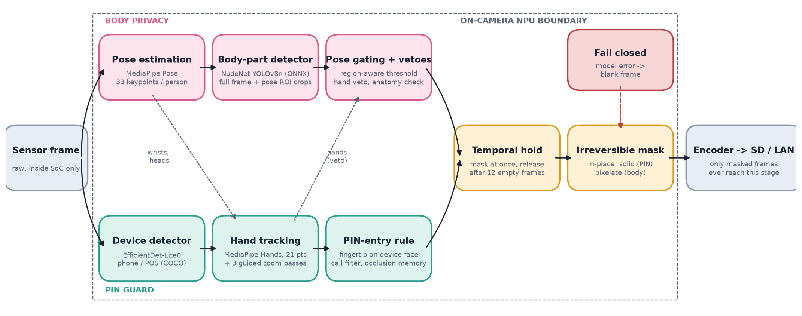
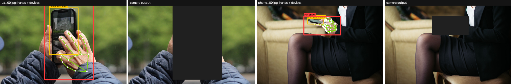

# Privacy-by-Design AI CCTV

**Leon Kaushik Deka** · Third Semester AIML Mini Project · October 2026

CCTV in hostels, banks and shops captures much more than it needs to. Residents in towels in a hostel corridor. A customer's fingers typing a UPI PIN at the billing counter. All of it is open to anyone in the control room, or to an attacker once they break into the system.

This project builds an AI pipeline that runs **inside the camera** and permanently masks only the sensitive regions before a frame can be stored or sent:

- **Body privacy:** pose detection (MediaPipe Pose) guides a pre-trained body-part detector (NudeNet, YOLOv8n) to find and pixelate nipples, buttocks and genitalia that are showing.
- **PIN guard:** a phone/POS detector (EfficientDet-Lite0) and hand tracking (MediaPipe Hands, 21 keypoints) spot a fingertip on a device, then fill the screen and the hand solid.

A PIN or a private body part has no forensic value anyway, so the rest of the video is still usable as evidence.



## How it works



- **Mask at the source:** masks are written into the frame buffer before encoding, so no unmasked recording exists.
- **Permanent masks:** solid fill (PIN) and coarse pixelation (body), never Gaussian blur (it can be partly reversed).
- **Mask early, release late:** a region is masked as soon as it's detected and stays masked for 12 frames after the last detection, so detector flicker can't expose single frames.
- **Fail closed:** if any model fails on a frame, the whole frame is withheld.
- Pose-guided crops, region-aware thresholds, hand/anatomy vetoes, guided zoom passes for small hands/phones, a phone-call filter, occlusion memory. See the [report](docs/Privacy_CCTV_Report_Leon_Kaushik_Deka.pdf) for details.



## Results

Tested on 55 hand-labelled, openly licensed images (laptop CPU, no GPU):

| Test | Result |
|---|---|
| PIN-entry regions fully protected (>= 90 % masked) | 4 / 8 (58.1 % mean coverage) |
| False alarms: device visible, nobody entering a PIN | 1 / 26 |
| False alarms: ordinary clothed people | 0 / 21 |
| Speed, busy 640x480 scene (3 detector branches in parallel) | 139 ms per frame (7.2 fps) |

All the misses were a hand or phone that the pre-trained detectors failed to detect (tiny, black-and-white, or behind a windscreen). No nude pictures were used, for ethical reasons, so there is no recall figure for body masking, only its false-alarm rate. Real-time speed needs a camera NPU. See the report for details and limitations.

## Deliverables

| File | Contents |
|---|---|
| [docs/Privacy_CCTV_Report_Leon_Kaushik_Deka.pdf](docs/Privacy_CCTV_Report_Leon_Kaushik_Deka.pdf) | Case-study report (all 12 sections, notebook screenshots in Appendix A) |
| [docs/Privacy_CCTV_Slides_Leon_Kaushik_Deka.pptx](docs/Privacy_CCTV_Slides_Leon_Kaushik_Deka.pptx) | 12-slide presentation |
| [docs/Abstract.pdf](docs/Abstract.pdf) | Project abstract |
| [notebooks/privacy_cctv_demo.ipynb](notebooks/privacy_cctv_demo.ipynb) | Stage-by-stage demo and evaluation, with outputs |
| [anatomy/cctv-camera/cctv-camera.html](anatomy/cctv-camera/cctv-camera.html) | Interactive exploded view of the camera (download and open in a browser) |

## Run it

Requires Python 3.12 (MediaPipe has no wheels for newer versions yet).

```bash
python -m venv .venv
.venv\Scripts\pip install -r requirements.txt          # Windows; use .venv/bin/pip elsewhere
.venv\Scripts\python scripts/fetch_assets.py            # downloads the MediaPipe models into models/
.venv\Scripts\python -m pytest tests                    # 31 unit tests
.venv\Scripts\jupyter lab notebooks/privacy_cctv_demo.ipynb
```

### Web app

```bash
.venv\Scripts\streamlit run app/streamlit_app.py
```

Opens http://localhost:8502 with three tabs: **Live camera** (browser webcam over WebRTC, masked on the server before it comes back to the page), **Try a file** (upload a photo or a short video, or pick a sample) and **Results** (evaluation numbers and figures). The profile and the label, body-privacy and mirror switches are in the sidebar.

### Live webcam demo

Only masked frames are ever shown or saved.

```bash
.venv\Scripts\python app/run_camera.py --labels --fullscreen
```

| Hold up | What you see |
|---|---|
| a phone or a POS terminal | pixelated (`PHONE / POS`) |
| a credit or debit card | pixelated (`CARD`) |
| a finger typing on the phone | phone and hand filled solid (`PIN ENTRY`) |

Keys: `l` labels on/off, `f` full screen, `q` quit. Add `--no-body` to skip body privacy for smoother frames. The default profile is `demo`; others are `retail`, `hostel` (also masks underwear-level regions), `bank` (masks every payment device and card) and `all`.

COCO has no card class. Cards are caught by re-running the object detector on a close crop around each tracked hand, where a held card is usually read as a phone or remote, so keep the card in your hand and facing the camera.

To record your own test with ground truth, add `--profile retail --record data/runs/demo.mp4 --log data/runs/demo.csv`, press `g` while actually typing a PIN, and run the last notebook cell on the log.

## Repository layout

```
privacy_cctv/        pipeline: detectors, body privacy, PIN guard, temporal hold, masking, metrics
app/run_camera.py    live webcam prototype (OpenCV window)
app/streamlit_app.py web app: live camera, file upload, results
notebooks/           demonstration and evaluation notebook
tests/               unit tests
data/samples/        test images + sources.json (author, licence and link for every image)
data/eval/           hand-labelled ground truth
scripts/             model download, figures, notebook screenshots, report and slide builders
anatomy/             interactive camera figure (built with the MIT-licensed anatomy kit)
docs/                report, slides, abstract, figures, notebook screenshots, results.json
```

## Credits

- Models: [MediaPipe](https://ai.google.dev/edge/mediapipe) Pose Landmarker, Hand Landmarker and EfficientDet-Lite0 (Google); [NudeNet](https://github.com/notAI-tech/NudeNet) body-part detector.
- Test images: [Wikimedia Commons](https://commons.wikimedia.org); each image's author and licence are listed in `data/samples/sources.json`.
- Camera figure kit: [anatomy](https://github.com/wheresryan22/anatomy) (MIT licence, see `anatomy/LICENSE`).
